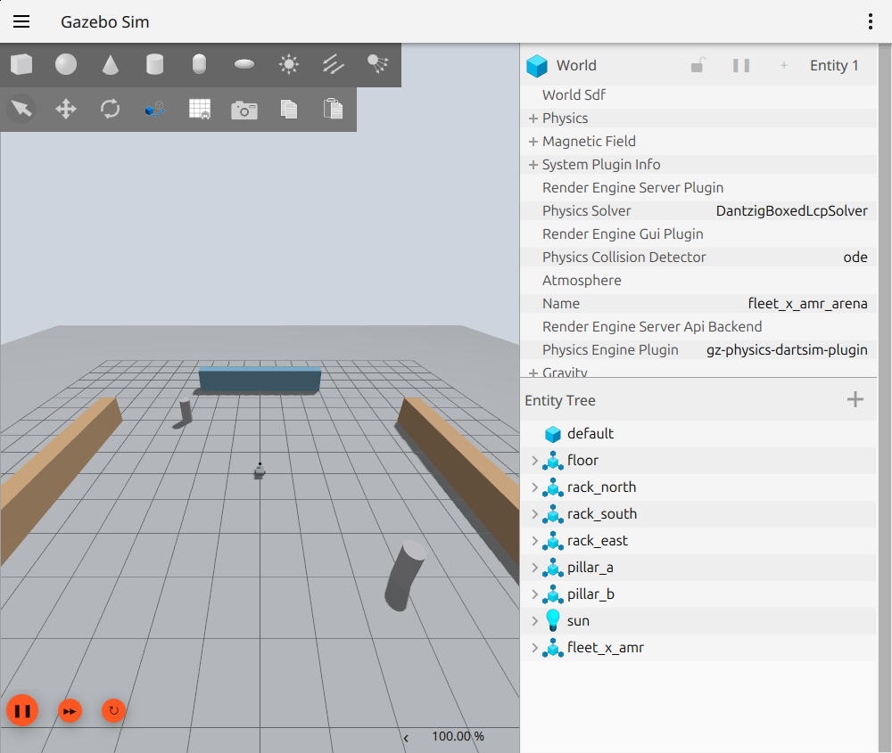
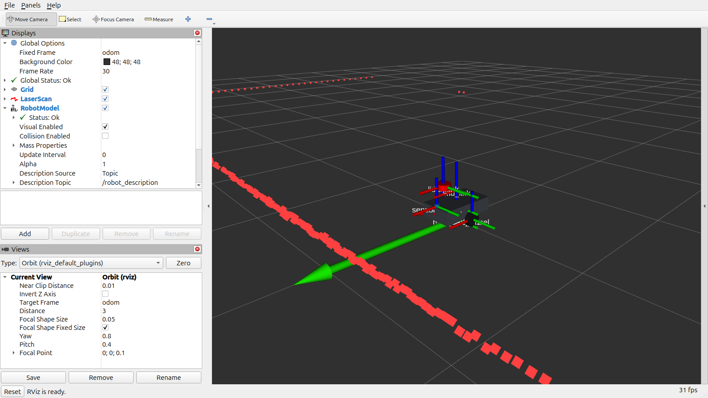
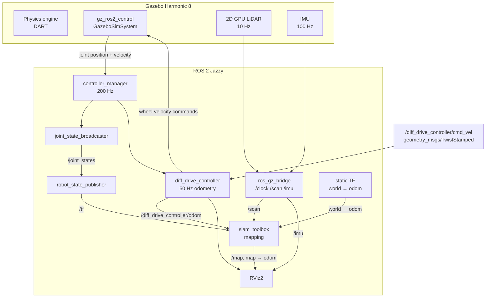
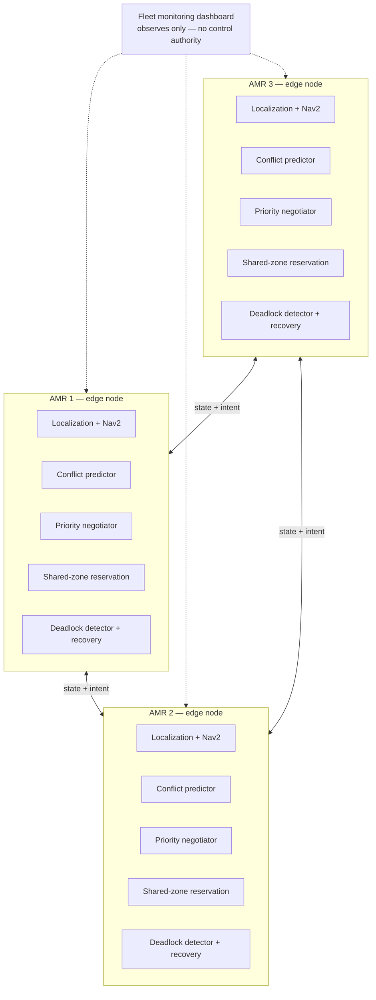
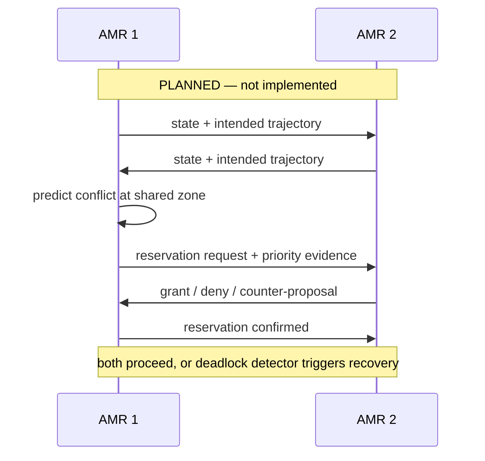
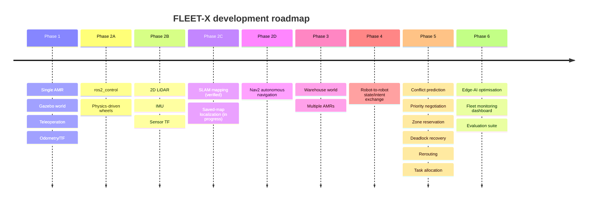

# FLEET-X

### Decentralized Edge Intelligence for Cooperative Autonomous Mobile Robots in Smart Warehouses

**Robots that communicate, negotiate and coordinate — without a central controller.**

[](https://docs.ros.org/en/jazzy/)
[](https://gazebosim.org/)
[](LICENSE)
[](#development-status)

---

> **Scope of this repository today**
>
> FLEET-X currently contains a **single, fully simulated autonomous mobile
> robot** with a physics-driven `ros2_control` drive chain, a 2D LiDAR, an IMU,
> and verified online SLAM mapping. The **decentralized multi-robot
> coordination layer is a documented design and roadmap item — it is not
> implemented yet.** Every status claim below is separated into
> *implemented and verified*, *in progress*, or *planned*.

---

## Table of contents

1. [Introduction](#1-introduction)
2. [Problem statement](#2-problem-statement)
3. [Proposed solution](#3-proposed-solution)
4. [What works today](#4-what-works-today)
5. [System architecture](#5-system-architecture)
6. [Repository layout](#6-repository-layout)
7. [Technology stack](#7-technology-stack)
8. [Installation](#8-installation)
9. [Running the simulation](#9-running-the-simulation)
10. [Testing](#10-testing)
11. [Development status](#11-development-status)
12. [Roadmap](#12-roadmap)
13. [Innovation case](#13-innovation-case)
14. [Documentation](#14-documentation)
15. [Contributing](#15-contributing)
16. [Security](#16-security)
17. [License](#17-license)
18. [Acknowledgements](#18-acknowledgements)

---

## 1. Introduction

Warehouses are becoming dense, dynamic robot environments. Autonomous mobile
robots (AMRs) share narrow aisles, intersections, loading zones and battery
stations. As fleets grow, coordinating those shared resources becomes the
hardest part of the system — harder than driving a single robot.

Most commercial fleets solve this with a **central fleet manager** that assigns
tasks and grants right-of-way. That architecture is simple to reason about, but
it creates three structural weaknesses:

- **Single point of failure** — if the central controller or its network path
  goes down, the fleet loses coordination.
- **Latency and bottlenecking** — every conflict must travel to the server and
  back before a robot can decide.
- **Poor scaling in communication-constrained environments** — dense fleets and
  weak wireless coverage make central coordination fragile.

**FLEET-X** explores the opposite architecture: each AMR is an intelligent edge
node that exchanges state and movement intent with nearby robots and participates
directly in conflict prediction, priority negotiation, shared-zone reservation,
deadlock detection and recovery, rerouting, and task allocation. A monitoring
dashboard observes the fleet; it is **not** the decision-maker.

The long-term goal is a reproducible research and engineering platform for
decentralized warehouse fleet coordination, built on ROS 2 Jazzy and Gazebo
Harmonic.

---

## 2. Problem statement

| Challenge | Why it matters |
|---|---|
| **Robot-to-robot coordination** | Robots must agree on who moves first without a central arbiter. |
| **Narrow aisle conflicts** | Two AMRs cannot pass in a one-robot-wide aisle; one must yield or reverse. |
| **Intersection congestion** | Multiple robots arriving together can gridlock a shared crossing. |
| **Deadlocks** | Circular waits can freeze part of a fleet even when every robot is individually healthy. |
| **Blocked aisles** | A stopped robot, dropped payload or human obstruction invalidates the planned route. |
| **Dynamic task allocation** | Tasks arrive continuously; assigning them centrally adds latency and a failure point. |
| **Distributed decision-making** | Decisions must remain safe and live under message loss, delay and partial knowledge. |

A single-robot simulation cannot answer these questions. FLEET-X is structured
so that the single-robot foundation is built and verified first, then extended
into a multi-robot, decentralized system.

---

## 3. Proposed solution

### 3.1 Concept

Every FLEET-X AMR is an **edge intelligence node** with four local capabilities:

1. **Perceive** — LiDAR, IMU, wheel state and localization.
2. **Announce** — broadcast its state (pose, velocity, health) and short-horizon
   movement intent.
3. **Reason** — predict conflicts with neighbours, negotiate priority, reserve
   shared zones, detect deadlock and choose a recovery action.
4. **Act** — follow, yield, reverse, reroute or re-offer a task, all locally.

There is no central controller in the decision loop. The fleet dashboard is a
read-only observer for operators and evaluators.

### 3.2 Design principles

- **Local-first:** a robot can act safely using only its own sensors.
- **Intent, not commands:** robots exchange what they plan to do, not direct
  control over each other.
- **Deterministic conflict rules:** priority is derived from a documented,
  reproducible policy (for example task urgency, waiting time, and a stable
  robot ID tie-break), not from ad-hoc races.
- **Fail-safe degradation:** loss of communication must reduce performance, not
  create unsafe motion.
- **Observability:** every negotiation and reservation decision is logged so
  that deadlocks and near-misses can be replayed offline.

### 3.3 What is deliberately *not* claimed

The coordination algorithms above are **design targets**, not working code in
this repository. The current release establishes the verified single-robot
substrate on which they will be built. See
[Development status](#11-development-status).

---

## 4. What works today

Verified on Ubuntu 24.04, ROS 2 Jazzy and Gazebo Harmonic 8.15:

- A custom differential-drive AMR described entirely in **URDF/Xacro**.
- A physics-driven **`ros2_control`** chain:
  `gz_ros2_control/GazeboSimSystem` → `joint_state_broadcaster` +
  `diff_drive_controller`.
- Closed-loop odometry from simulated wheel state and a correct TF tree
  (`world → odom → base_footprint → base_link → {wheels, lidar_link, imu_link}`).
- A simulated **360° 2D LiDAR** publishing `sensor_msgs/msg/LaserScan` on
  `/scan` at 10 Hz.
- A simulated **IMU** publishing `sensor_msgs/msg/Imu` on `/imu` at 100 Hz.
- **Online SLAM mapping** with `slam_toolbox`: `/map` and `map → odom` are
  published from live scan and odometry data.
- A launch-time geometry cross-check that refuses to start if the URDF wheel
  geometry and the controller YAML disagree.
- Reproducible headless and GUI workflows, plus a smoke-test script.

The screenshots below are from the simulated system in this repository.

| Gazebo Harmonic | RViz2 |
|---|---|
|  |  |

---

## 5. System architecture

### 5.1 Current single-robot architecture (implemented)



**Key frames**

```text
world ──(static)──> odom ──(diff_drive_controller)──> base_footprint
                                                         │
                                                   (fixed joint)
                                                         ▼
                                                     base_link
                                      ┌──────────────┼──────────────┐
                                      ▼              ▼              ▼
                               left_wheel      right_wheel     lidar_link
                                                                  imu_link
```

### 5.2 Planned decentralized fleet architecture (design only)



Everything inside the three AMR blocks above the communication links is
**planned**. No negotiation, reservation, deadlock or task-allocation node
exists in the current codebase.

### 5.3 Planned message flow



See [communication_architecture.md](docs/architecture/communication_architecture.md)
for the full design note and open questions.

---

## 6. Repository layout

```text
FLEET-X/
├── README.md
├── LICENSE
├── CONTRIBUTING.md
├── .gitignore
├── .gitattributes
├── src/
│   └── fleet_x_amr/
│       ├── CMakeLists.txt
│       ├── package.xml
│       ├── urdf/          # Xacro robot description, sensors, ros2_control
│       ├── launch/        # simulation, SLAM mapping, localization
│       ├── config/        # controller and slam_toolbox parameters
│       ├── worlds/        # Gazebo Harmonic arena
│       ├── rviz/          # FLEET-X RViz2 configuration
│       └── maps/          # saved maps (none committed yet)
├── scripts/
│   ├── fleet_x_env.sh
│   ├── fleet_x_start.sh
│   ├── fleet_x_stop.sh
│   └── setup_fleet_x.sh
├── tests/
│   └── smoke_test.sh
├── config/
│   └── fastdds_localhost_profile.xml
├── docs/
│   ├── architecture/
│   ├── development/
│   └── images/
└── .github/
    ├── ISSUE_TEMPLATE/
    └── workflows/
```

ROS 2 packages stay under `src/`; simulation assets stay inside `fleet_x_amr`
so that `package://`, `$(find fleet_x_amr)` and install rules remain valid.

---

## 7. Technology stack

| Layer | Technology | Status |
|---|---|---|
| OS | Ubuntu 24.04 LTS | Used |
| Middleware | ROS 2 Jazzy Jalisco | Used |
| Simulator | Gazebo Harmonic (gz-sim 8.15) | Used |
| Robot description | URDF + Xacro | Used |
| Control | `ros2_control`, `gz_ros2_control`, `diff_drive_controller`, `joint_state_broadcaster` | Used |
| ROS/Gazebo bridge | `ros_gz_bridge`, `ros_gz_sim` | Used |
| Sensors | Gazebo `gpu_lidar`, Gazebo `imu` | Used |
| Mapping | `slam_toolbox` (online asynchronous) | Mapping verified; localization in progress |
| Visualization | RViz2 | Used |
| Languages | Python 3 (launch/config), XML/Xacro | Used |
| Build | colcon / ament_cmake | Used |
| Testing | `ament_lint_auto`, shell smoke test | Used |
| Version control | Git / GitHub | Used |

**Not currently used by this repository:** Nav2 (planned), custom C++ nodes
(planned), NetworkX/SciPy coordination solvers (planned), machine learning
frameworks (planned), a web dashboard (planned). They are listed in the roadmap
only where genuinely intended.

---

## 8. Installation

### 8.1 Prerequisites

- Ubuntu 24.04 LTS (x86_64)
- ROS 2 Jazzy installed from the official ROS repositories
- A working graphics stack for the Gazebo GUI (headless mode also supported)

Install the runtime dependencies:

```bash
sudo apt update
sudo apt install -y \
  ros-jazzy-desktop \
  ros-jazzy-ros-gz \
  ros-jazzy-ros-gz-sim \
  ros-jazzy-ros-gz-bridge \
  ros-jazzy-ros2-control \
  ros-jazzy-ros2-controllers \
  ros-jazzy-diff-drive-controller \
  ros-jazzy-joint-state-broadcaster \
  ros-jazzy-xacro \
  ros-jazzy-robot-state-publisher \
  ros-jazzy-tf2-ros \
  ros-jazzy-slam-toolbox \
  ros-jazzy-teleop-twist-keyboard \
  python3-colcon-common-extensions \
  python3-rosdep
```

### 8.2 Clone and build

```bash
git clone https://github.com/ayub-14/FLEET-X.git
cd FLEET-X

source /opt/ros/jazzy/setup.bash
sudo rosdep init 2>/dev/null || true
rosdep update
rosdep install --from-paths src --ignore-src -r -y

colcon build --symlink-install
source install/setup.bash
```

If you clone into `~/fleet_x_ws`, the convenience script also works:

```bash
source ~/fleet_x_ws/scripts/setup_fleet_x.sh
```

---

## 9. Running the simulation

All commands below assume a sourced workspace:

```bash
cd ~/fleet_x_ws        # or your clone location
source /opt/ros/jazzy/setup.bash
source install/setup.bash
```

### 9.1 Full simulation (Gazebo GUI + RViz2)

```bash
ros2 launch fleet_x_amr fleet_x_amr_sim.launch.py
```

This starts Gazebo Harmonic, spawns the AMR, unpauses the world, starts
`robot_state_publisher`, the clock and sensor bridges, and activates both
controllers. Wait for:

```text
[diff_drive_controller] activate successful
[joint_state_broadcaster] activate successful
```

### 9.2 Headless simulation

```bash
ros2 launch fleet_x_amr fleet_x_amr_sim.launch.py gui:=false rviz:=false
```

Useful for CI, SSH sessions and automated checks.

### 9.3 Teleoperation

`diff_drive_controller` in this configuration accepts
`geometry_msgs/msg/TwistStamped` on `/diff_drive_controller/cmd_vel`:

```bash
ros2 run teleop_twist_keyboard teleop_twist_keyboard --ros-args \
  -p stamped:=true \
  -p frame_id:=base_link \
  -r cmd_vel:=/diff_drive_controller/cmd_vel
```

Keys: `i/j/k/l` to move, `k` to stop, `q` to quit.

### 9.4 Inspect LiDAR and IMU

```bash
ros2 topic hz /scan
ros2 topic echo /scan --once
ros2 topic hz /imu
ros2 topic echo /imu --once
```

- `/scan` — `sensor_msgs/msg/LaserScan`, frame `lidar_link`, 360 samples,
  ±π, 0.08–12 m, 10 Hz.
- `/imu` — `sensor_msgs/msg/Imu`, frame `imu_link`, 100 Hz, with configured
  Gaussian noise.

The RViz2 configuration already includes a LaserScan display for `/scan` and
odometry for `/diff_drive_controller/odom`.

### 9.5 Check controllers and TF

```bash
ros2 control list_controllers
ros2 control list_hardware_interfaces
ros2 run tf2_ros tf2_echo world lidar_link
ros2 run tf2_ros tf2_echo imu_link base_link
```

Expected controllers:

```text
joint_state_broadcaster  joint_state_broadcaster/JointStateBroadcaster  active
diff_drive_controller    diff_drive_controller/DiffDriveController      active
```

### 9.6 Online SLAM mapping (verified)

With the simulation running, start `slam_toolbox` in a second terminal:

```bash
source /opt/ros/jazzy/setup.bash
source install/setup.bash
ros2 launch fleet_x_amr slam_mapping.launch.py
```

Drive the AMR with teleoperation. Verify:

```bash
ros2 topic echo /map --once
ros2 run tf2_ros tf2_echo map odom
```

Save the map:

```bash
ros2 run nav2_map_server map_saver_cli -f \
  "$HOME/fleet_x_ws/src/fleet_x_amr/maps/fleet_x_map"
```

### 9.7 Localization against a saved map (in progress)

`src/fleet_x_amr/launch/slam_localization.launch.py` is the localization
scaffold. It requires `maps/fleet_x_map.yaml`, which is **not committed yet**.
The launch is therefore intentionally not presented as a working workflow:

```bash
# Only after saving a map:
ros2 launch fleet_x_amr slam_localization.launch.py rviz:=false
```

### 9.8 Headless smoke test

```bash
./tests/smoke_test.sh
```

The script starts the simulation headless, checks controllers, topics, TF,
sensor payloads and a short motion command, then shuts the simulation down.

---

## 10. Testing

### 10.1 Package lint tests

```bash
source /opt/ros/jazzy/setup.bash
colcon build --symlink-install
colcon test --packages-select fleet_x_amr
colcon test-result --verbose
```

The package runs the standard `ament_lint_auto` suite (copyright, flake8,
pep257, XML lint).

### 10.2 Runtime smoke test

```bash
./tests/smoke_test.sh
```

It verifies:

- package build artefacts exist,
- both controllers reach `active`,
- `/scan` and `/imu` publish the expected message types,
- the TF chain resolves,
- a stamped velocity command produces odometry change,
- the simulation is shut down cleanly afterwards.

### 10.3 What is not covered

There are no automated multi-robot tests yet, because the multi-robot layer does
not exist. No test result in this repository should be read as evidence for the
planned coordination algorithms.

---

## 11. Development status

| Phase | Feature | Status |
|---|---|---|
| **Phase 1** | Custom differential-drive AMR, original URDF/Xacro, Gazebo Harmonic world, teleoperation, odometry and TF | **Completed** — baseline architecture, later superseded by the `ros2_control` drive chain |
| **Phase 2A** | `ros2_control` integration: `GazeboSimSystem`, `diff_drive_controller`, `joint_state_broadcaster`, physics-driven wheel feedback, odometry | **Verified** (re-verified 2026-10-30) |
| **Phase 2B** | Simulated 2D LiDAR (`/scan`), simulated IMU (`/imu`), dedicated sensor frames, sensor TF | **Verified** (re-verified 2026-10-30) |
| **Phase 2C** | SLAM mapping | **Mapping verified 2026-10-30**; saved-map localization and AMCL-class localization **in progress** |
| **Phase 2D** | Nav2 autonomous navigation for the FLEET-X AMR | **Planned** — no Nav2 configuration is present for `fleet_x_amr` |
| **Phase 3** | Multi-AMR simulation in a warehouse world | **Planned** |
| **Phase 4** | Decentralized robot-to-robot communication | **Planned / design only** |
| **Phase 5** | Fleet coordination: conflict prediction, priority negotiation, zone reservation, deadlock recovery, rerouting, task allocation | **Planned / design only** |
| **Phase 6** | Edge-AI optimisation and fleet monitoring dashboard | **Planned / design only** |

Legend: **Verified** = executed on this platform and checked against live ROS 2
interfaces. **In progress** = code or configuration exists but the end-to-end
workflow is not yet verified. **Planned** = design only, no implementation.

---

## 12. Roadmap



**Next concrete milestones**

1. Save a verified occupancy map from the Phase 2C mapping run.
2. Complete and validate localization against that map.
3. Bring up Nav2 for a single AMR with a warehouse-scale world.
4. Instantiate three AMRs with unique namespaces and TF prefixes.
5. Implement and test the state/intent message layer.
6. Add conflict, reservation and deadlock scenarios with reproducible tests.

---

## 13. Innovation case

For the **Seva First Innovation Challenge 2026 — Maharashtra Zone**, FLEET-X
addresses a practical warehouse problem: coordination should survive when the
network, the server or a single robot does not.

The innovative direction is the **decentralized edge-intelligence architecture**:

- robots negotiate locally instead of waiting for a central grant,
- priority decisions are explicit, auditable and reproducible,
- shared zones are reserved through a distributed protocol,
- deadlocks are detected and recovered locally,
- task allocation can degrade gracefully under communication loss.

The repository is deliberately honest about maturity: it demonstrates a verified
single-robot foundation and documents the multi-robot layer as a structured,
testable engineering plan. This makes the project useful both as a technical
portfolio and as a reproducibility resource for reviewers.

---

## 14. Documentation

| Document | Contents |
|---|---|
| [system_architecture.md](docs/architecture/system_architecture.md) | Current ROS/Gazebo data flow, frames, topics and verification notes |
| [robot_architecture.md](docs/architecture/robot_architecture.md) | Chassis, wheels, joints, sensor mounting and geometry invariants |
| [communication_architecture.md](docs/architecture/communication_architecture.md) | Planned decentralized coordination protocol (design only) |
| [PHASE_1_REPORT.md](docs/development/PHASE_1_REPORT.md) | Baseline AMR and simulation |
| [PHASE_2A_REPORT.md](docs/development/PHASE_2A_REPORT.md) | `ros2_control` integration |
| [PHASE_2B_REPORT.md](docs/development/PHASE_2B_REPORT.md) | LiDAR and IMU integration |
| [PHASE_2C_REPORT.md](docs/development/PHASE_2C_REPORT.md) | SLAM mapping results and localization status |
| [SECURITY_AUDIT.md](docs/SECURITY_AUDIT.md) | Pre-publication security and third-party review |

---

## 15. Contributing

Contributions are welcome, especially:

- Nav2 integration and warehouse-scale worlds,
- multi-robot spawning and namespacing,
- decentralized coordination protocols and deadlock recovery,
- reproducible scenario tests and metrics,
- documentation and simulation assets.

Please read [CONTRIBUTING.md](CONTRIBUTING.md) before opening a pull request.
In short:

1. Fork the repository and create a focused branch.
2. Keep ROS 2 package names, launch paths and install rules valid.
3. Run `colcon test` and `./tests/smoke_test.sh`.
4. Describe what you verified, on which platform, and what remains unverified.
5. Do not add credentials, personal data or unlicensed third-party assets.

---

## 16. Security

This repository is public. Before publication it was scanned for tokens, API
keys, passwords, private keys, personal paths and unlicensed third-party code.
No credentials were found in the tracked source.

- Never commit `.env` files, tokens or private keys.
- Report security concerns privately to the maintainers rather than in a public
  issue.
- The detailed audit is in [docs/SECURITY_AUDIT.md](docs/SECURITY_AUDIT.md).

---

## 17. License

FLEET-X is released under the **Apache License 2.0**. See [LICENSE](LICENSE).

ROS 2, Gazebo, `ros2_control`, `slam_toolbox` and other dependencies remain under
their own upstream licenses. They are dependencies, not FLEET-X code, and this
repository does not claim authorship of them.

---

## 18. Acknowledgements

- [ROS 2 Jazzy](https://docs.ros.org/en/jazzy/) and the ROS community.
- [Gazebo Harmonic](https://gazebosim.org/) and the Gazebo Sim team.
- [`ros2_control`](https://control.ros.org/) and the `gz_ros2_control` project.
- [`slam_toolbox`](https://github.com/SteveMacenski/slam_toolbox) for online
  mapping.
- The open-source robotics community whose documentation and examples made
  this work reproducible.

Early exploration in this workspace referenced Josh Newans' *Articubot One*
package. That package has no licence declaration and is **not redistributed**
in this repository; the FLEET-X robot, description, world, control chain and
documentation are the project's own work. See
[docs/development/PHASE_1_REPORT.md](docs/development/PHASE_1_REPORT.md).

---

**FLEET-X** · Built with ROS 2 Jazzy and Gazebo Harmonic · Seva First Innovation
Challenge 2026 — Maharashtra Zone
