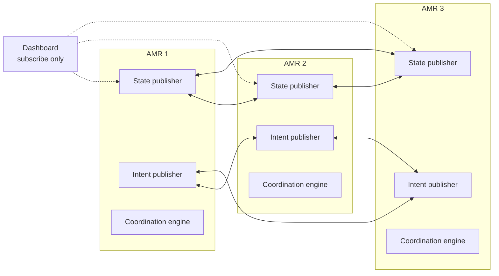
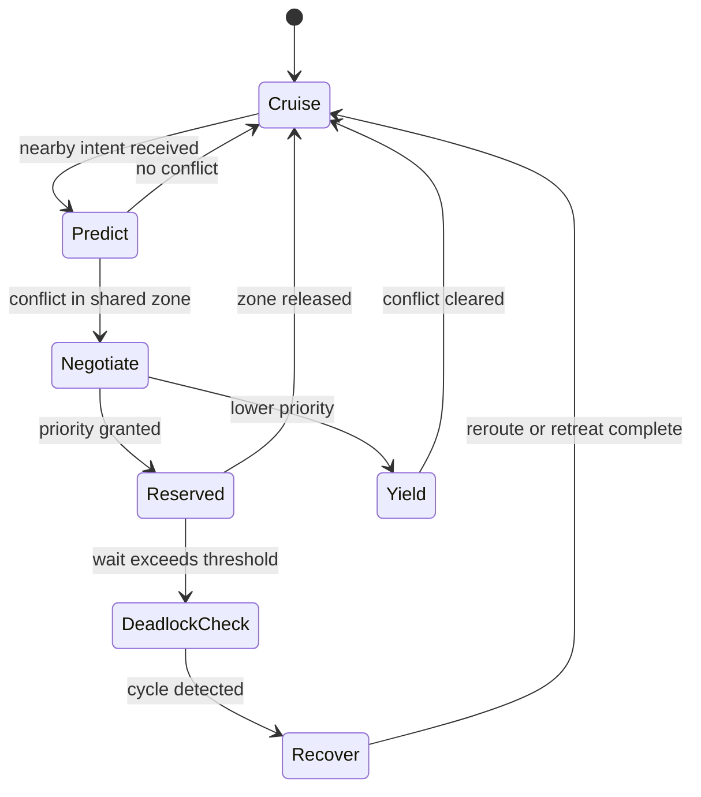

# FLEET-X Communication Architecture

> **Status: design only.**
>
> No decentralized communication, negotiation, reservation, deadlock recovery or
> task-allocation code exists in this repository yet. This document records the
> intended architecture so that the next phases have a concrete, testable
> target. Nothing here should be cited as implemented behaviour.

## 1. Why decentralized?

A central fleet manager is easy to build but concentrates failure, latency and
authority. FLEET-X instead treats every AMR as an edge node that:

- knows its own state and short-horizon intent,
- discovers nearby peers,
- evaluates conflicts locally,
- participates in a deterministic negotiation,
- records the outcome for offline analysis.

The operator dashboard is a **monitor**, not a controller.

## 2. Planned network model

Assumptions to be validated:

- peer discovery on a local network segment (DDS discovery or an explicit
  registry-free discovery mechanism),
- bounded message latency,
- lossy links,
- no reliance on a central clock.

## 3. Planned state and intent messages

| Message | Purpose | Cadence |
|---|---|---|
| `RobotState` | Pose, twist, battery/health, current task, current zone | 10 Hz |
| `MovementIntent` | Short-horizon path or corridor, target zone, expected arrival | 5–10 Hz |
| `ZoneReservation` | Request / grant / release for a shared zone | event-driven |
| `PriorityClaim` | Task urgency, waiting time, robot ID, evidence | event-driven |
| `DeadlockReport` | Wait-for graph fragment and proposed recovery | event-driven |

These are design names, not ROS message definitions in this repository.

## 4. Planned coordination loop

### 4.1 Conflict prediction

For each nearby peer, project both intents over a short horizon and test for:

- spatial overlap of swept corridors,
- temporal overlap within a safety margin,
- shared-zone contention,
- head-on aisle conflicts,
- intersection arrival collisions.

### 4.2 Priority negotiation

A deterministic priority order is required so that two robots never both yield
or both proceed. A candidate policy:

1. safety-critical state (fault, emergency stop),
2. task deadline urgency,
3. accumulated waiting time,
4. stable robot-ID tie-break.

The policy must be identical on every robot and must be logged with the evidence
used. Ties must never be resolved by race timing.

### 4.3 Shared-zone reservation

A zone is a named region (aisle segment, intersection, charger). A robot may
enter only with a valid reservation. Reservations have:

- owner robot ID,
- zone ID,
- grant epoch,
- expiry / heartbeat,
- release reason.

Stale reservations must expire safely. A robot that loses communication must
not silently keep a zone forever.

### 4.4 Deadlock detection and recovery

Each robot maintains a local wait-for graph from observed reservations and
blocked intents. A cycle triggers a recovery policy: lowest-priority robot
retreats, reroutes, or releases its reservation, then re-announces intent.

### 4.5 Dynamic rerouting and task allocation

Rerouting and task allocation are downstream of conflict handling. Candidate
approaches include:

- corridor-level cost updates after a blocked-aisle report,
- distributed auction or contract-net style task offers,
- local re-offer when a robot cannot complete a task.

These are research directions, not implemented features.

## 5. Failure modes to test

| Failure | Expected safe behaviour |
|---|---|
| Message loss | Conservative yielding; no unsafe entry |
| Delayed intent | Reservation timeout; re-plan |
| Robot disappears mid-zone | Lease expiry; peers recover the zone |
| Simultaneous claims | Deterministic tie-break; no double grant |
| Circular wait | Deadlock detector breaks the cycle |
| Clock skew | Logical epochs, not wall-clock ordering |
| Dashboard offline | Fleet continues; monitoring is not control |

## 6. Planned evaluation metrics

- deadlock frequency per 100 conflict events,
- average delay per intersection,
- reservation utilisation,
- reroute count and distance overhead,
- task completion time and fairness,
- behaviour under injected packet loss and latency.

No such metrics have been measured yet.

## 7. Implementation boundary

The current repository provides:

- a verified single-robot state source (`/odom`, `/scan`, `/imu`, `/joint_states`),
- a verified simulation and launch pattern,
- no multi-robot namespacing or peer communication.

The next implementation step is to spawn multiple namespaced AMRs and add a
read-only state/intent exchange before any negotiation logic. See the roadmap in
the top-level README.
