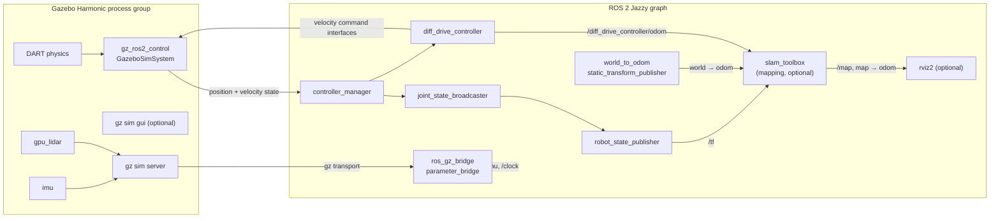

# FLEET-X System Architecture

Status: **implemented and verified for a single AMR**.
Last verification: 2026-10-30 on Ubuntu 24.04, ROS 2 Jazzy, Gazebo Harmonic
8.15.0.

This document describes what runs today. The decentralized fleet layer is
described separately in [communication_architecture.md](communication_architecture.md)
and is **not implemented**.

## 1. Runtime composition



## 2. Launch sequence

`fleet_x_amr_sim.launch.py` performs the following steps:

1. Read `urdf/fleet_x_amr_dimensions.xacro` and
   `config/fleet_x_amr_controllers.yaml`, and abort if wheel radius or wheel
   separation disagree.
2. Render the Xacro description.
3. Start the Gazebo server (and GUI unless `gui:=false`).
4. Start the clock bridge, the sensor bridge, `robot_state_publisher` and the
   static `world → odom` transform.
5. After 3 s, call the Gazebo world-control service to unpause the simulation
   (with retries, because the world may start paused).
6. After 8 s, spawn the AMR from `/robot_description`.
7. After 10 s, spawn `joint_state_broadcaster` and `diff_drive_controller`.
8. Optionally start RViz2 unless `rviz:=false`.

The Gazebo system plugin `gz_ros2_control::GazeboSimROS2ControlPlugin` creates
the `controller_manager` inside the Gazebo process. It is configured by
`$(find fleet_x_amr)/config/fleet_x_amr_controllers.yaml`.

## 3. Controllers

| Controller | Type | State | Interfaces |
|---|---|---|---|
| `joint_state_broadcaster` | `joint_state_broadcaster/JointStateBroadcaster` | active | Publishes all joint states |
| `diff_drive_controller` | `diff_drive_controller/DiffDriveController` | active | Claims `left_wheel_joint/velocity`, `right_wheel_joint/velocity` |

Controller manager update rate: **200 Hz**.
Odometry publish rate: **50 Hz**.
Command timeout: **0.5 s**.

`diff_drive_controller` uses:

- `left_wheel_names: ["left_wheel_joint"]`
- `right_wheel_names: ["right_wheel_joint"]`
- `wheel_separation: 0.30 m`
- `wheel_radius: 0.05 m`
- `base_frame_id: base_footprint`
- `odom_frame_id: odom`
- `enable_odom_tf: true`
- `open_loop: false`

The command interface is `geometry_msgs/msg/TwistStamped` on
`/diff_drive_controller/cmd_vel`.

## 4. Verified topics

| Topic | Type | Direction | Notes |
|---|---|---|---|
| `/clock` | `rosgraph_msgs/msg/Clock` | Gazebo → ROS | Bridged |
| `/scan` | `sensor_msgs/msg/LaserScan` | Gazebo → ROS | 360 samples, 10 Hz, frame `lidar_link` |
| `/imu` | `sensor_msgs/msg/Imu` | Gazebo → ROS | 100 Hz, frame `imu_link` |
| `/diff_drive_controller/cmd_vel` | `geometry_msgs/msg/TwistStamped` | ROS → controller | Velocity command |
| `/diff_drive_controller/odom` | `nav_msgs/msg/Odometry` | controller → ROS | 50 Hz |
| `/joint_states` | `sensor_msgs/msg/JointState` | broadcaster → ROS | Physics-derived wheel state |
| `/tf`, `/tf_static` | `tf2_msgs/msg/TFMessage` | ROS | Full frame tree |
| `/robot_description` | `std_msgs/msg/String` | `robot_state_publisher` | Rendered URDF |
| `/map` | `nav_msgs/msg/OccupancyGrid` | `slam_toolbox` | Only while mapping is running |

## 5. TF tree

```text
world
└── odom                       (static_transform_publisher, identity)
    └── base_footprint         (diff_drive_controller)
        └── base_link          (fixed, z = 0.10 m)
            ├── left_wheel     (continuous, axis +Y, y = +0.15 m)
            ├── right_wheel    (continuous, axis −Y, y = −0.15 m)
            ├── lidar_link     (fixed, xyz = 0.12, 0, 0.18 m)
            └── imu_link       (fixed, xyz = 0, 0, 0.12 m)
```

`slam_toolbox` adds `map → odom` while mapping or localizing.

## 6. Verified runtime checks

The following were exercised against a live headless simulation:

```text
$ ros2 control list_controllers
joint_state_broadcaster  joint_state_broadcaster/JointStateBroadcaster  active
diff_drive_controller    diff_drive_controller/DiffDriveController      active

$ ros2 control list_hardware_interfaces
left_wheel_joint/velocity   [available] [claimed]
right_wheel_joint/velocity  [available] [claimed]
left_wheel_joint/position
left_wheel_joint/velocity
right_wheel_joint/position
right_wheel_joint/velocity
```

A stamped velocity command produced measurable displacement and yaw in
`/diff_drive_controller/odom`; wheel joint positions advanced. `/scan` and
`/imu` published valid messages with frames `lidar_link` and `imu_link`.
`slam_toolbox` published `/map` and a `map → odom` transform.

## 7. Known limitations

- Only one robot is instantiated. There are no namespaces, TF prefixes or
  multi-robot launch arguments yet.
- No Nav2 configuration exists for `fleet_x_amr`.
- `slam_localization.launch.py` is a scaffold; no map asset is committed and the
  localization flow is not verified.
- The IMU orientation covariance is zero-filled by the simulator bridge; do not
  treat it as a calibrated covariance.
- Sensors are simulated. No real hardware interface has been validated.
- The RViz configuration is intentionally minimal (robot, TF, odometry, scan).

## 8. Reproducing the architecture check

```bash
source /opt/ros/jazzy/setup.bash
cd ~/fleet_x_ws
colcon build --symlink-install
source install/setup.bash
ros2 launch fleet_x_amr fleet_x_amr_sim.launch.py gui:=false rviz:=false
```

In another terminal, source the workspace and query the interfaces listed above.
